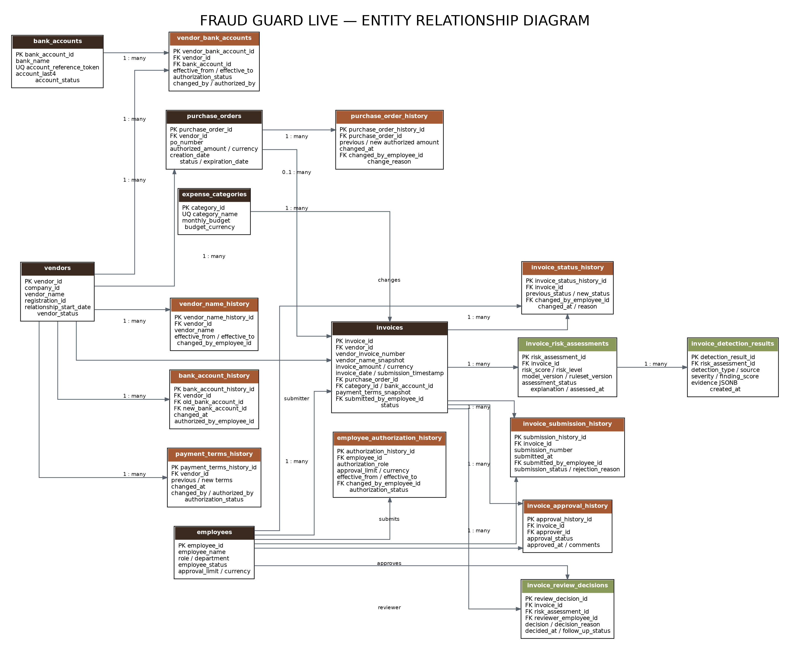
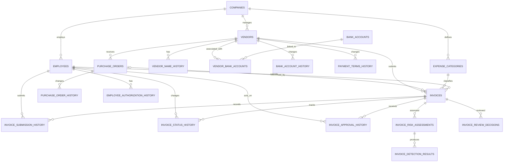

# Fraud Guard Live — Data Dictionary

**Version:** 1.0 (design draft)  
**Last updated:** 5 November 2026  
**Project:** Supplier Invoice Fraud Detection and Risk Intelligence

## 1. Purpose

Fraud Guard Live evaluates supplier invoices before payment. It combines deterministic business rules with machine-learning signals, presents evidence to authorized reviewers, and records human decisions. A risk flag is an investigation signal—not proof of fraud—and the application does not autonomously release payments.

This document describes the proposed PostgreSQL relational model. It is a design baseline, not a claim that these tables have already been implemented.

## 2. Design principles

1. **Preserve history.** Changes to vendor, bank-account association, payment terms, purchase orders, employee authorization, invoice status, and invoice review are recorded as history/audit events.
2. **Keep audit history append-only.** Do not silently update or delete historical events. Correct mistakes with a new correction/reversal event that references the original.
3. **Snapshot invoice-time facts.** Store relevant vendor/payment details as they were submitted so later profile changes do not rewrite the invoice's historical context.
4. **Separate validation from detection.** Reject structurally invalid data (for example, a malformed amount or unknown required reference); accept structurally valid business discrepancies (for example, invoice amount above PO amount) and flag them for review.
5. **Separate assessments from evidence.** One invoice may have multiple risk assessments over time. Each assessment may produce multiple individual detection results.
6. **Keep humans authoritative.** Review decisions are stored separately from model outputs. A model score is not a fraud verdict.
7. **Prevent temporal leakage.** Features used to assess an invoice may only use information available at the assessment time.

## 3. Conventions

- `PK` = primary key; `FK` = foreign key; `UQ` = unique constraint.
- `BIGINT` identifiers are generated identity values unless otherwise specified.
- Monetary values use `NUMERIC(18,2)` with a three-character ISO currency code. Do not use floating-point types for money.
- Timestamps use `TIMESTAMPTZ` and are stored consistently in UTC.
- Effective date ranges use inclusive `effective_from` and exclusive `effective_to`; `NULL effective_to` means currently effective.
- Sensitive bank details should never be stored as plain text. Store a provider token or keyed hash and only a masked display value/last four digits where needed.
- Enum-like values are shown as suggested allowed values; implement with PostgreSQL enums or checked text columns.

## 4. Entity relationship diagram

Fraud Guard Live supports multiple customer organizations. Each vendor, employee, and expense category belongs to one company. Application queries and authorization checks must enforce company-level data isolation.

The ER diagram below shows the proposed entities, key fields and relationships. The full-resolution image is stored beside this document as `ERD_FRAUD_GUARD_LIVE.png`. The Mermaid source below is also included so the diagram can be regenerated or edited.

## 5. Core tables

### 5.1 Organization management

#### `companies`
Stores each organization that uses Fraud Guard Live. Company ownership is the tenant boundary for vendor, employee, and expense-category data.

| Column | Type | Key / rules | Description |
|---|---|---|---|
| `company_id` | BIGINT | PK | Internal organization identifier. |
| `company_name` | VARCHAR(255) | Required | Organization name. |
| `created_at` | TIMESTAMPTZ | Required | Record creation time. |

### 5.2 Vendor management

#### `vendors`
Stores the current supplier profile.

| Column | Type | Key / rules | Description |
|---|---|---|---|
| `vendor_id` | BIGINT | PK | Internal supplier identifier. |
| `company_id` | BIGINT | FK / required | Organization using Fraud Guard Live; not the supplier's registration number. |
| `vendor_name` | VARCHAR(200) | Required | Current supplier name. |
| `registration_id` | VARCHAR(100) | Nullable | Supplier's business registration/tax identifier, if available. |
| `relationship_start_date` | DATE | Required | Date the organization began its relationship with the supplier. |
| `vendor_status` | VARCHAR(20) | ACTIVE, INACTIVE, BLOCKED | Current supplier status. |
| `created_at` | TIMESTAMPTZ | Required | Record creation time. |
| `updated_at` | TIMESTAMPTZ | Required | Last update to the current profile. |

#### `vendor_name_history`
Preserves previous supplier names. Historical rows are append-only.

| Column | Type | Key / rules | Description |
|---|---|---|---|
| `vendor_name_history_id` | BIGINT | PK | History record identifier. |
| `vendor_id` | BIGINT | FK → vendors | Supplier whose name changed. |
| `vendor_name` | VARCHAR(200) | Required | Name valid during this period. |
| `effective_from` | TIMESTAMPTZ | Required | Start of validity. |
| `effective_to` | TIMESTAMPTZ | Nullable | End of validity; NULL if current. |
| `recorded_at` | TIMESTAMPTZ | Required | When the history row was recorded. |
| `changed_by_employee_id` | BIGINT | FK → employees, nullable | Employee who recorded the change. |
| `change_reason` | TEXT | Nullable | Reason/evidence for the change. |

#### `bank_accounts`
Stores bank-account identities without exposing raw account numbers.

| Column | Type | Key / rules | Description |
|---|---|---|---|
| `bank_account_id` | BIGINT | PK | Internal bank-account identifier. |
| `bank_name` | VARCHAR(150) | Nullable | Financial institution name. |
| `account_reference_token` | VARCHAR(255) | UQ / required | Secure token or keyed hash used to compare account identity. |
| `account_last4` | CHAR(4) | Nullable | Masked display suffix only. |
| `account_status` | VARCHAR(20) | ACTIVE, INACTIVE | Current account status. |
| `created_at` | TIMESTAMPTZ | Required | When the account record was created. |

#### `vendor_bank_accounts`
Associative table resolving the many-to-many relationship between vendors and bank accounts. It also records the period during which an association was valid.

| Column | Type | Key / rules | Description |
|---|---|---|---|
| `vendor_bank_account_id` | BIGINT | PK | Association record identifier. |
| `vendor_id` | BIGINT | FK → vendors | Vendor associated with the account. |
| `bank_account_id` | BIGINT | FK → bank_accounts | Associated bank account. |
| `effective_from` | TIMESTAMPTZ | Required | When the association became effective. |
| `effective_to` | TIMESTAMPTZ | Nullable | When it stopped being effective; NULL means current. |
| `authorization_status` | VARCHAR(20) | PENDING, APPROVED, REJECTED | Authorization state of the association/change. |
| `changed_by_employee_id` | BIGINT | FK → employees, nullable | Employee who initiated/recorded the association. |
| `authorized_by_employee_id` | BIGINT | FK → employees, nullable | Employee who authorized it. |
| `change_reason` | TEXT | Nullable | Reason for adding/removing the association. |

#### `bank_account_history`
Audit events for bank-account changes. This supplements the effective-dated association rows with a readable change event and authorization trail.

| Column | Type | Key / rules | Description |
|---|---|---|---|
| `bank_account_history_id` | BIGINT | PK | Change event identifier. |
| `vendor_id` | BIGINT | FK → vendors | Vendor whose bank details changed. |
| `old_bank_account_id` | BIGINT | FK → bank_accounts, nullable | Previous account, if any. |
| `new_bank_account_id` | BIGINT | FK → bank_accounts, nullable | New account, if any. |
| `changed_at` | TIMESTAMPTZ | Required | Time of the change. |
| `changed_by_employee_id` | BIGINT | FK → employees, nullable | Employee who initiated the change. |
| `authorized_by_employee_id` | BIGINT | FK → employees, nullable | Employee who authorized the change. |
| `authorization_status` | VARCHAR(20) | PENDING, APPROVED, REJECTED | Authorization outcome. |
| `change_reason` | TEXT | Nullable | Explanation or supporting reference. |

#### `payment_terms_history`
Preserves changes to a vendor's payment terms.

| Column | Type | Key / rules | Description |
|---|---|---|---|
| `payment_terms_history_id` | BIGINT | PK | History record identifier. |
| `vendor_id` | BIGINT | FK → vendors | Vendor whose terms changed. |
| `previous_payment_terms` | VARCHAR(100) | Nullable | Previous terms, e.g. Net 30. |
| `new_payment_terms` | VARCHAR(100) | Required | New terms. |
| `changed_at` | TIMESTAMPTZ | Required | Change time. |
| `changed_by_employee_id` | BIGINT | FK → employees, nullable | Employee who initiated the change. |
| `authorized_by_employee_id` | BIGINT | FK → employees, nullable | Employee who authorized the change. |
| `authorization_status` | VARCHAR(20) | PENDING, APPROVED, REJECTED | Authorization outcome. |
| `change_reason` | TEXT | Nullable | Reason for the change. |

### 5.3 Invoice management

#### `invoices`
Main invoice record. Stores current workflow status plus snapshots of relevant supplier/payment information at submission time. A structurally valid invoice that exceeds its PO amount is retained and flagged; it is not rejected solely for that business discrepancy.

| Column | Type | Key / rules | Description |
|---|---|---|---|
| `invoice_id` | BIGINT | PK | Internal invoice identifier. |
| `vendor_id` | BIGINT | FK → vendors / required | Supplier that submitted the invoice. |
| `vendor_invoice_number` | VARCHAR(120) | Required, indexed with vendor_id | Invoice number assigned by the supplier. Do not make this unique: potential duplicates must be retained for review. |
| `vendor_name_snapshot` | VARCHAR(200) | Required | Supplier name as recorded at submission. |
| `invoice_amount` | NUMERIC(18,2) | Required, CHECK >= 0 | Invoice amount. |
| `currency` | CHAR(3) | Required | ISO currency code. |
| `invoice_date` | DATE | Required | Date printed/issued on the invoice. |
| `submission_timestamp` | TIMESTAMPTZ | Required | Time the system received the submission. |
| `purchase_order_id` | BIGINT | FK → purchase_orders, nullable | Related purchase order, if supplied. |
| `category_id` | BIGINT | FK → expense_categories, nullable | Expense category. |
| `cost_code` | VARCHAR(80) | Nullable | Internal accounting/cost-center code. |
| `payment_terms_snapshot` | VARCHAR(100) | Nullable | Payment terms at submission time. |
| `bank_account_id` | BIGINT | FK → bank_accounts, nullable | Account identity used for the invoice at submission. |
| `bank_account_reference_snapshot` | VARCHAR(255) | Nullable | Secure token/reference snapshot; never raw account number. |
| `submitted_by_employee_id` | BIGINT | FK → employees, nullable | Employee who submitted/entered the invoice. |
| `status` | VARCHAR(30) | Required | Current workflow status, e.g. PENDING, UNDER_REVIEW, APPROVED, REJECTED, ON_HOLD, PAID. |
| `created_at` | TIMESTAMPTZ | Required | Record creation time. |
| `updated_at` | TIMESTAMPTZ | Required | Last update to current invoice state. |

**Duplicate handling:** retain possible duplicates. Use a combination of vendor, invoice number, amount, invoice date, PO and other attributes to generate a duplicate signal. Do not rely on invoice number alone, and do not automatically label a match as fraud.

#### `invoice_submission_history`
Records each submission attempt, including rejected and resubmitted attempts.

| Column | Type | Key / rules | Description |
|---|---|---|---|
| `submission_history_id` | BIGINT | PK | Submission event identifier. |
| `invoice_id` | BIGINT | FK → invoices | Invoice being submitted. |
| `submission_number` | INTEGER | Required | Sequence number for this invoice's submissions. |
| `submitted_at` | TIMESTAMPTZ | Required | Submission attempt time. |
| `submitted_by_employee_id` | BIGINT | FK → employees, nullable | Employee responsible for the submission. |
| `submission_status` | VARCHAR(20) | SUBMITTED, REJECTED, RESUBMITTED | Outcome/state of this attempt. |
| `rejection_reason` | TEXT | Nullable | Reason for rejection, if applicable. |

#### `invoice_status_history`
Append-only record of invoice workflow transitions.

| Column | Type | Key / rules | Description |
|---|---|---|---|
| `invoice_status_history_id` | BIGINT | PK | Status event identifier. |
| `invoice_id` | BIGINT | FK → invoices | Invoice whose status changed. |
| `previous_status` | VARCHAR(30) | Nullable | Status before the transition. |
| `new_status` | VARCHAR(30) | Required | Status after the transition. |
| `changed_by_employee_id` | BIGINT | FK → employees, nullable | Employee/system actor responsible. |
| `changed_at` | TIMESTAMPTZ | Required | Transition time. |
| `reason` | TEXT | Nullable | Explanation for the transition. |

#### `invoice_approval_history`
Records approval actions and the employee who performed them. Approval events are distinct from general workflow status transitions.

| Column | Type | Key / rules | Description |
|---|---|---|---|
| `approval_history_id` | BIGINT | PK | Approval event identifier. |
| `invoice_id` | BIGINT | FK → invoices | Invoice being reviewed for approval. |
| `approver_id` | BIGINT | FK → employees | Employee who acted as approver. |
| `approval_status` | VARCHAR(20) | PENDING, APPROVED, REJECTED | Approval outcome. |
| `approved_at` | TIMESTAMPTZ | Nullable | Time the approval action occurred. |
| `comments` | TEXT | Nullable | Approver's comments. |

### 5.4 Procurement and employees

#### `purchase_orders`
Stores the current authorized purchase order.

| Column | Type | Key / rules | Description |
|---|---|---|---|
| `purchase_order_id` | BIGINT | PK | Internal PO identifier. |
| `vendor_id` | BIGINT | FK → vendors | Supplier assigned to the PO. |
| `po_number` | VARCHAR(120) | Required | Business-facing PO number. |
| `authorized_amount` | NUMERIC(18,2) | Required, CHECK >= 0 | Currently authorized amount. |
| `currency` | CHAR(3) | Required | ISO currency code. |
| `creation_date` | DATE | Required | PO creation date. |
| `status` | VARCHAR(30) | DRAFT, PENDING_APPROVAL, APPROVED, ACTIVE, CLOSED, CANCELLED, EXPIRED | Current PO status. |
| `expiration_date` | DATE | Nullable | Date after which the PO is no longer valid. |

#### `purchase_order_history`
Tracks changes to the authorized PO amount and other relevant PO changes. The current authorized amount remains in `purchase_orders`; historical values are preserved here.

| Column | Type | Key / rules | Description |
|---|---|---|---|
| `purchase_order_history_id` | BIGINT | PK | PO change event identifier. |
| `purchase_order_id` | BIGINT | FK → purchase_orders | PO that changed. |
| `previous_authorized_amount` | NUMERIC(18,2) | Nullable | Amount before the change. |
| `new_authorized_amount` | NUMERIC(18,2) | Nullable | Amount after the change. |
| `changed_at` | TIMESTAMPTZ | Required | Change time. |
| `changed_by_employee_id` | BIGINT | FK → employees, nullable | Employee who initiated the change. |
| `change_reason` | TEXT | Nullable | Reason for the change. |

#### `employees`
Stores employees who submit invoices, approve transactions, modify supplier records or investigate alerts.

| Column | Type | Key / rules | Description |
|---|---|---|---|
| `employee_id` | BIGINT | PK | Internal employee identifier. |
| `company_id` | BIGINT | FK → companies / required | Organization this employee belongs to. |
| `employee_name` | VARCHAR(200) | Required | Employee display name. |
| `role` | VARCHAR(80) | Required | Role, e.g. Accounts Payable, Procurement, Finance Manager, Fraud Reviewer. |
| `department` | VARCHAR(100) | Nullable | Employee department. |
| `employee_status` | VARCHAR(20) | ACTIVE, INACTIVE | Current employment/system status. |
| `approval_limit` | NUMERIC(18,2) | Nullable | Current approval limit, if applicable. |
| `approval_currency` | CHAR(3) | Nullable | Currency for the approval limit. |

#### `employee_authorization_history`
Preserves changes to employee approval limits and authorization assignments.

| Column | Type | Key / rules | Description |
|---|---|---|---|
| `authorization_history_id` | BIGINT | PK | Authorization history identifier. |
| `employee_id` | BIGINT | FK → employees | Employee whose authorization changed. |
| `authorization_role` | VARCHAR(80) | Required | Permission/approval role being recorded. |
| `approval_limit` | NUMERIC(18,2) | Nullable | Authorized monetary limit during this period. |
| `approval_currency` | CHAR(3) | Nullable | Currency for the limit. |
| `effective_from` | TIMESTAMPTZ | Required | Start of authorization validity. |
| `effective_to` | TIMESTAMPTZ | Nullable | End of validity; NULL means current. |
| `changed_by_employee_id` | BIGINT | FK → employees, nullable | Employee who recorded the change. |
| `authorization_status` | VARCHAR(20) | PENDING, APPROVED, REVOKED | Authorization state. |

#### `expense_categories`
Defines expense categories and their current budget baseline.

| Column | Type | Key / rules | Description |
|---|---|---|---|
| `category_id` | BIGINT | PK | Expense category identifier. |
| `company_id` | BIGINT | FK → companies / required | Organization that owns this category. |
| `category_name` | VARCHAR(120) | Required; UQ with `company_id` | Category name, e.g. IT Equipment or Transportation. |
| `monthly_budget` | NUMERIC(18,2) | Nullable | Current monthly budget for the category in the MVP. |
| `budget_currency` | CHAR(3) | Nullable | Currency for the budget. |

**Future refinement:** if budgets vary by month, year, department or cost center, replace the single current budget fields with a separate effective-dated `category_budgets` table.

### 5.5 Fraud detection and human review

#### `invoice_risk_assessments`
Stores each overall risk assessment. Multiple assessments can exist for one invoice as history accumulates or models/rules change.

| Column | Type | Key / rules | Description |
|---|---|---|---|
| `risk_assessment_id` | BIGINT | PK | Assessment identifier. |
| `invoice_id` | BIGINT | FK → invoices | Invoice assessed. |
| `risk_score` | NUMERIC(5,2) | Required, CHECK 0–100 | Composite risk score; not a probability of fraud unless explicitly calibrated. |
| `risk_level` | VARCHAR(20) | LOW, MEDIUM, HIGH, CRITICAL | Risk band derived from documented thresholds. |
| `model_version` | VARCHAR(80) | Nullable | ML model/version identifier; NULL for rule-only assessments. |
| `ruleset_version` | VARCHAR(80) | Nullable | Rule-engine version used. |
| `assessment_status` | VARCHAR(30) | COMPLETED, FAILED, SUPERSEDED | Assessment processing state. |
| `explanation` | TEXT | Nullable | Human-readable overall explanation. |
| `assessed_at` | TIMESTAMPTZ | Required | Assessment time. |

#### `invoice_detection_results`
Stores individual rule/model findings that contribute evidence to an assessment. An assessment can produce zero or many results.

| Column | Type | Key / rules | Description |
|---|---|---|---|
| `detection_result_id` | BIGINT | PK | Detection finding identifier. |
| `risk_assessment_id` | BIGINT | FK → invoice_risk_assessments | Assessment that produced this finding. |
| `detection_type` | VARCHAR(100) | Required | Detection identifier, e.g. DUPLICATE_PATTERN, UNUSUAL_AMOUNT, RECENT_BANK_CHANGE. |
| `detection_source` | VARCHAR(20) | RULE, ML, HYBRID | Source of the finding. |
| `severity` | VARCHAR(20) | INFO, LOW, MEDIUM, HIGH, CRITICAL | Finding severity. |
| `finding_score` | NUMERIC(5,2) | Nullable | Optional normalized score for this finding. |
| `evidence` | JSONB | Required | Structured, explainable evidence and relevant feature values. Do not put secrets or raw bank data here. |
| `created_at` | TIMESTAMPTZ | Required | Finding creation time. |

#### `invoice_review_decisions`
Stores human investigation outcomes separately from model assessments. Each row represents a review decision or a subsequent decision event.

| Column | Type | Key / rules | Description |
|---|---|---|---|
| `review_decision_id` | BIGINT | PK | Review decision identifier. |
| `invoice_id` | BIGINT | FK → invoices | Invoice under investigation. |
| `risk_assessment_id` | BIGINT | FK → invoice_risk_assessments, nullable | Assessment considered by the reviewer. |
| `reviewer_employee_id` | BIGINT | FK → employees | Authorized employee who made the decision. |
| `decision` | VARCHAR(20) | APPROVE, REJECT, ESCALATE, REQUEST_INFO | Human decision. |
| `decision_reason` | TEXT | Required | Explanation for the decision. |
| `decided_at` | TIMESTAMPTZ | Required | Decision time. |
| `follow_up_status` | VARCHAR(30) | Nullable | Optional investigation follow-up state. |

## 6. Main relationships and cardinalities

| Relationship | Cardinality | Explanation |
|---|---|---|
| Company → Vendor | One-to-many | Each vendor belongs to one customer organization. |
| Company → Employee | One-to-many | Each employee belongs to one customer organization. |
| Company → Expense category | One-to-many | Each expense category belongs to one customer organization. |
| Vendor → Invoice | One-to-many | One vendor can submit many invoices; each invoice belongs to one vendor. |
| Vendor ↔ Bank account | Many-to-many | Vendors may use multiple accounts over time; an account may be associated with multiple vendors. `vendor_bank_accounts` resolves the relationship and stores effective dates. |
| Vendor → Name history | One-to-many | A vendor can have multiple historical names. |
| Vendor → Purchase order | One-to-many | A vendor can receive multiple POs. |
| Purchase order → Invoice | One-to-many / optional on invoice | A PO can be referenced by multiple invoices; an invoice may have no PO. |
| Invoice → Risk assessment | One-to-many | Each reassessment is retained. |
| Risk assessment → Detection result | One-to-many | One assessment can produce multiple findings. |
| Invoice → Review decision | One-to-many | Review events are retained over time. |
| Invoice → Submission/status/approval history | One-to-many | Each workflow event is separately recorded. |

## 7. Engineered ML features (derived, not source tables)

These values are calculated from source records as of the assessment timestamp. They should be materialized in a feature dataset or feature store only when useful; they are not automatically columns in the transactional tables.

| Feature | Meaning | Source data |
|---|---|---|
| `vendor_average_invoice_amount` | Historical average invoice amount for the vendor | Prior invoices |
| `vendor_amount_deviation` | Difference or normalized deviation from the vendor's historical amount baseline | Invoice + prior invoices |
| `vendor_invoice_frequency` | Number/rate of invoices in a defined lookback window | Prior invoices |
| `submission_delay_days` | Days between invoice date and submission timestamp | Invoice |
| `bank_account_change_recency` | Time since the account association changed | Vendor-bank association/history |
| `shared_bank_account_count` | Number of vendors associated with the same account at assessment time | Vendor-bank associations |
| `po_amount_deviation` | Invoice amount compared with PO authorized amount at the relevant time | Invoice + PO history |
| `approver_frequency` | Historical approval frequency for an employee/vendor or category combination | Approval history |
| `payment_terms_change_recency` | Time since vendor payment terms changed | Payment terms history |
| `category_budget_deviation` | Spending compared with the applicable category budget | Invoices + budget data |

**Temporal rule:** when assessing invoice X at time T, do not use invoices, approvals, profile changes or review outcomes that occurred after T to calculate its features. Split training/evaluation data by time where appropriate.

## 8. Rule-based detection examples

- Potential duplicate invoice: compare vendor, invoice number, amount, invoice date, PO and other available attributes.
- Invoice exceeds PO authorization: compare invoice amount with the PO amount effective at the time of the invoice; flag for review rather than rejecting solely for the discrepancy.
- Recent bank-account change followed by a large invoice.
- Same bank account associated with multiple vendors.
- Invoice amount unusually high relative to the vendor's prior history.
- Approval made by an employee whose authorization limit/role was insufficient at the time.
- Unusual payment-term changes, PO amount changes or approval patterns.
- Repeated invoices just below an approval threshold (possible invoice splitting).

These are risk indicators. Legitimate business explanations must remain possible and visible to reviewers.

## 9. Implementation notes and open refinements

1. Multi-tenancy is part of the design: `companies` is the tenant table, and `vendors`, `employees`, and `expense_categories` each reference it through a required `company_id`. Enforce tenant-level data isolation in every relevant application query and authorization check.
2. Consider a dedicated `category_budgets` table before supporting multiple budget periods, departments or cost centers.
3. Define exact authorization rules and role/permission behavior in the application layer; the `role` and history fields alone do not enforce authorization.
4. Add indexes on foreign keys and common investigation queries, especially `invoices(vendor_id, vendor_invoice_number)`, `invoices(submission_timestamp)`, `invoice_risk_assessments(invoice_id, assessed_at)`, and `vendor_bank_accounts(bank_account_id, effective_from, effective_to)`.
5. Use database constraints to prevent invalid effective-date ranges and overlapping active associations where the business rule requires it.
6. Use transactions when updating a current profile and inserting its corresponding history event, so the two changes cannot become inconsistent.
7. Keep raw invoice document storage and OCR/extraction metadata out of the initial MVP if the first version ingests structured invoice data only. They can be added later.
8. Define how `invoice_status_history`, `invoice_approval_history` and `invoice_review_decisions` interact: status history records workflow transitions; approval history records approval actions; review decisions record investigation outcomes. Avoid duplicating the same event in multiple tables without a clear purpose.

## 10. MVP implementation priority

Implement the minimum tables needed for a complete end-to-end flow first:

1. `vendors`, `employees`, `expense_categories`
2. `bank_accounts`, `vendor_bank_accounts`
3. `purchase_orders`
4. `invoices`
5. `invoice_status_history`, `invoice_approval_history`
6. `invoice_risk_assessments`, `invoice_detection_results`
7. `invoice_review_decisions`

Add detailed history tables and advanced authorization history as the corresponding workflows are implemented. The full design remains the target model, but the MVP should be built incrementally.
